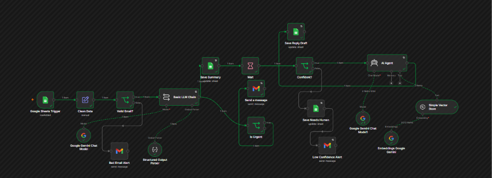
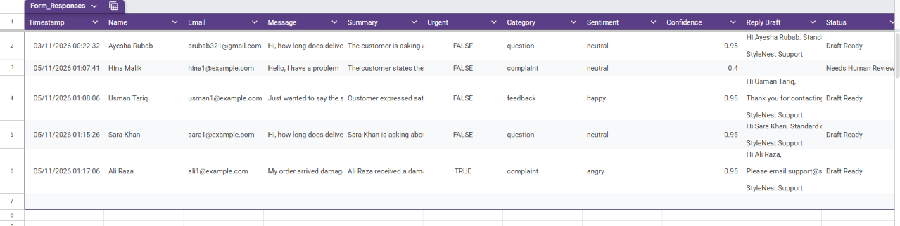
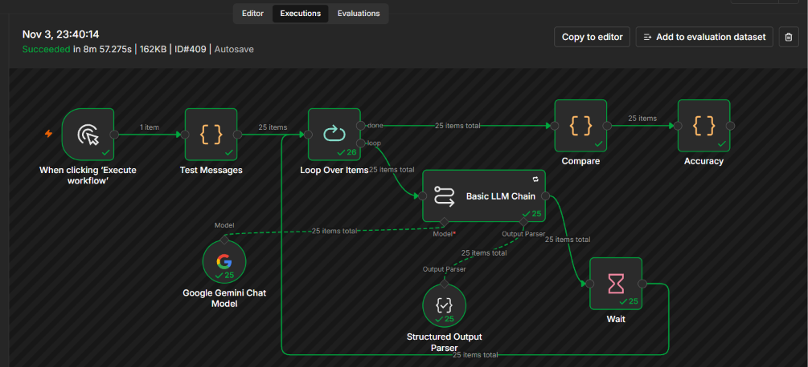
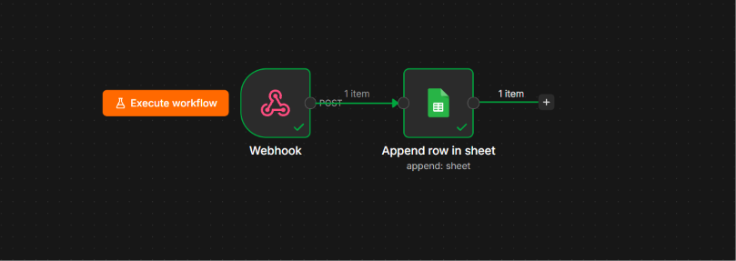
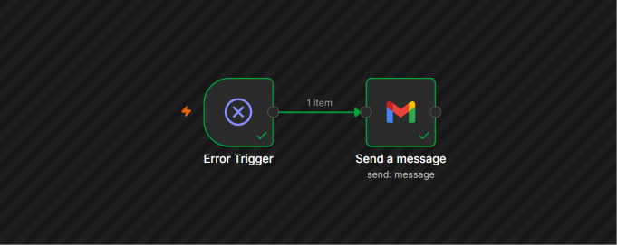

# AI Customer Support Assistant (n8n)

A portfolio project built with n8n and Google Gemini. It reads customer messages, classifies them, drafts replies from an FAQ, and raises alerts for urgent or unclear messages.

The shop (StyleNest) is fictional. This project runs locally in Docker. It is not a production system and has not been tested with real customers.

## Problem

Small online shops get customer messages every day: order questions, complaints and refund requests. The owner reads them one by one, so a simple question can wait for hours and an urgent message (for example "my payment was taken twice") can be buried between ordinary ones.

This project is a prototype for a fictional shop, StyleNest. It reads each message, labels its category and urgency, drafts a reply from the shop's FAQ, and alerts a human when a message is urgent or the AI is not confident.

## What it does

* Takes customer messages from a Google Form (and from a Webhook, see below)
* Cleans the data and checks that the email is valid
* Uses Gemini to return structured JSON: summary, category, sentiment, urgent, confidence
* Sends a Gmail alert when a message is urgent
* If the AI is not confident (confidence below 0.7), saves the status "Needs Human Review" and sends an alert instead of writing a reply
* Otherwise an AI agent drafts a reply using only the FAQ (RAG with a vector store)
* Saves everything in a Google Sheet
* A separate Error Handler workflow emails me when the main workflow fails

## Architecture

Main workflow "AI Support Assistant":

Google Sheets Trigger (Row Added) -> Clean Data -> Valid Email? (false: Bad Email Alert)
-> Basic LLM Chain (Gemini + Structured Output Parser)

* Save Summary -> Wait -> Confident?

  * true: AI Agent (FAQ RAG) -> Save Reply Draft (Status: Draft Ready)
  * false: Save Needs Human (Status: Needs Human Review) -> Low Confidence Alert (Gmail)
* Is Urgent? -> Urgent Gmail alert

Other workflows:

* FAQ Loader: loads faq.md into an in-memory vector store (run manually)
* FAQ Answer Test: chat test for the FAQ agent
* Evaluation: runs 25 labeled test messages and computes accuracy
* Webhook Intake: Webhook (POST) -> Google Sheets (Append row), so messages can be sent with curl or Postman. The main workflow picks up the new row.
* Error Handler: Error Trigger -> Gmail with workflow name, failed node, error message and execution link

## Tech stack

* n8n Community Edition, self-hosted in Docker
* Google Gemini free tier (gemini-3.5-flash-lite)
* Google Sheets and Gmail
  
## Error handling

- Retry on Fail is turned on for six nodes: Save Summary, Basic LLM Chain, Send a message (urgent alert), Save Reply Draft, AI Agent and Save Needs Human.
- On the Save Summary node, On Error is set to "Stop Workflow", so a failed save stops the run.
- The Error Handler workflow (Error Trigger -> Gmail) sends the workflow name, failed node, error message and execution link. It only works if it is chosen as the Error workflow in the main workflow settings (see Setup, step 4).

## Evaluation

I built an Evaluation workflow with 25 labeled test messages (expected category and expected urgent value).

|Prompt|Messages|Category|Urgent|
|-|-|-|-|
|v1|20|20/20|19/20|
|v2 (broader urgent rules)|25|25/25|22/25|
|v3 (5 clear urgent rules + "not urgent" list)|25|25/25|25/25|

Honest caveats:

* I wrote the 25 messages myself, so the set is small and easy.
* I wrote prompt v3 after looking at the errors in this same test set. 25/25 is not proof of 100% accuracy.
* Real customer messages are untested.
* Lesson: broadening the rule in v2 fixed one case and broke three others. Clear rules with explicit examples worked better.

## Limitations

* Runs locally; not deployed or tested in production.
* The vector store is in memory. After an n8n or Docker restart, run FAQ Loader again, otherwise the agent answers with the fallback "A human agent will contact you soon".
* The low-confidence step is an escalation alert, not a full human approval system (there is no approve button).
* The Gemini free tier allows 15 requests per minute, so the Evaluation workflow uses a loop with a Wait node.
* The Error Handler runs only when it is Published and a workflow fails on its own, not on manual Execute. It was triggered by real failed runs on 14 Nov. On those runs the alert email was not sent, because the Gmail credential needed to be reconnected. After I reconnected the credential, I received the test alert email.
* The Webhook was tested with the Test URL and a manual run of the main workflow. The production Webhook URL with the main workflow Active is not tested yet.
*  There is no rate limit on alerts: a failure that repeats creates one alert per failed run.
*  The Webhook has no authentication (Authentication: None). Anyone who can reach the URL can add a message. It is only reachable on localhost unless I expose it. Before any real use, add Header Auth.
*  Rows are matched by Email, so a second message from the same email can overwrite the results of the first one.
*  Prompt injection was not tested on this project. The customer message goes straight to Gemini. Injection tests exist in my separate Support Agent project.

  


## Setup (short)

1. 1. Run n8n in Docker (my setup: https://github.com/Ayesha-rubab-08/n8n-docker-setup) and open http://localhost:5678.
2. Import the workflow JSON files from the workflows folder.
3. Create your own credentials: Google (Sheets and Gmail) and Google Gemini API key. No credentials are included in this repo.
4. In the main workflow, open Settings and choose "Error Handler" as the Error workflow. Without this step, no failure alert is sent.
5. Create a Google Form and a Google Sheet with these headers: Timestamp, Name, Email, Message, Summary, Urgent, Category, Sentiment, Confidence, Reply Draft, Status.
6. Run the FAQ Loader workflow once to load faq.md into the vector store.
7. Test with a new email address for each message (rows are matched by Email).

Test the Webhook (Test URL, after clicking Listen for test event):

Windows (PowerShell):

```
Invoke-RestMethod -Method Post -Uri http://localhost:5678/webhook-test/support-message -ContentType "application/json" -Body '{"name":"Test User","email":"new@example.com","message":"Where is my order?"}'
```

macOS or Linux:

```
curl -X POST http://localhost:5678/webhook-test/support-message -H "Content-Type: application/json" -d '{"name":"Test User","email":"new@example.com","message":"Where is my order?"}'
```

## Screenshots

Main workflow:



Sheet results (summary, category, reply draft, status):



Evaluation result:



Webhook Intake workflow:



Error Handler run:




## Files

* faq.md: the FAQ used for RAG
* notes.md: my build notes, errors and fixes
* test\_messages.csv: the first 20 labeled test messages (messages 21-25 exist only in the Evaluation workflow)
* workflows/: exported workflow JSON (credentials removed)
* screenshots/: images used in this README

